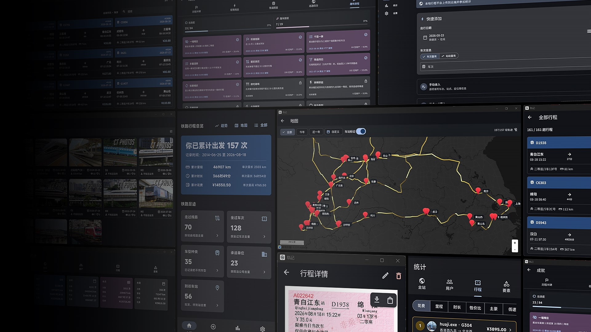
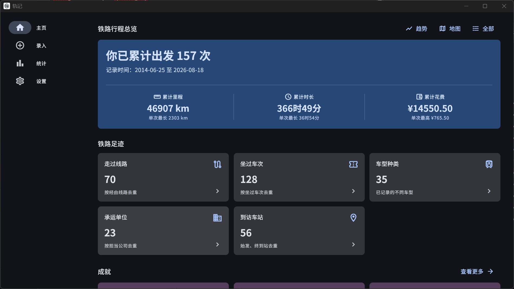
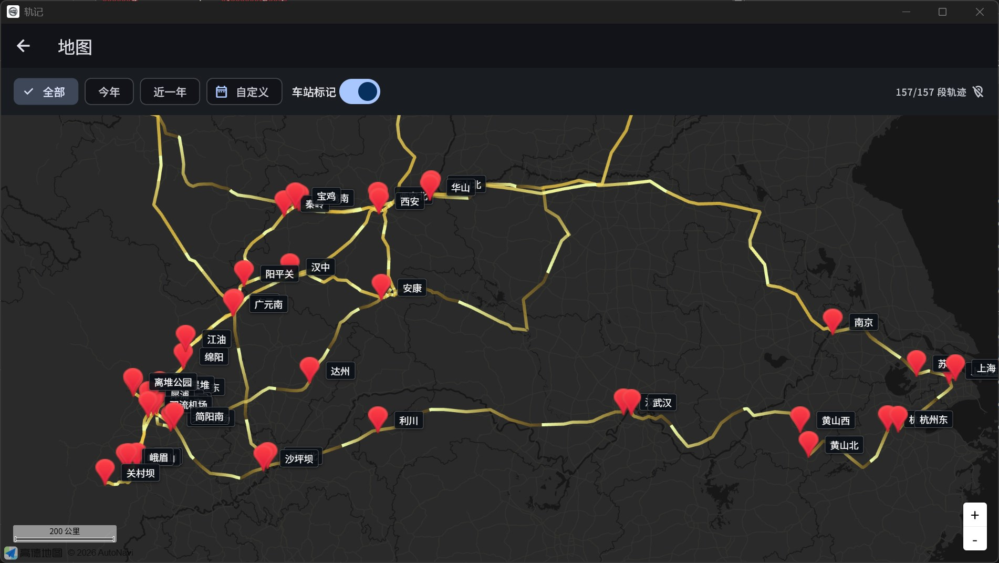
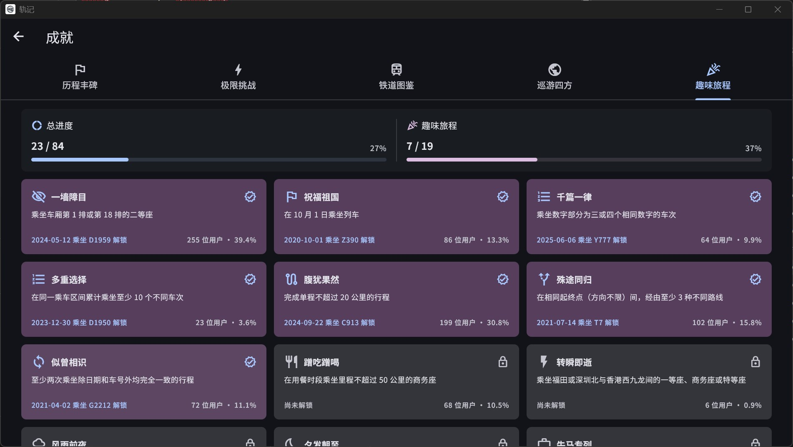

<h1>RailLog 轨记</h1>

<b>把每一次坐火车，都变成可以回看的旅程。</b>

面向铁路爱好者的个人行程记录与可视化应用。 
记下车次、站点、席别、票价与经由， 
再用统计、地图和成就，把它们整理成一份属于自己的铁路档案。

  
  
  

  
  
  
  
  
  

  

## 这是什么

RailLog（轨记）是一款面向铁路爱好者的行程记录应用。它要做的事很简单：**把散落在记忆里的乘车经历，整理成一份可以翻阅、统计和回看的铁路档案。**

车次、车站、席别、票价、里程、经由、车型与承运单位，都记录在同一条行程里；统计图表负责回答「坐了多少、花了多少、常走哪条线」，铁路地图负责回答「去过哪里、还有哪里没去」，成就系统则把那些特别的旅程标记下来。

客户端基于 Flutter 构建，覆盖 Windows、macOS、Linux、Android 与 iOS；数据默认保存在本机，登录后可在多台设备之间同步。

## 下载与安装

> **推荐**：Windows 用户优先选择 Microsoft Store 版本，可随商店自动更新；其他平台请从下方链接获取最新安装包。各平台安装包发布在 [GitHub Releases](https://github.com/denglihong2007/RailLog/releases/latest)，Microsoft Store 版本单独发布与更新。

### 选择你的平台

| 平台 | 获取方式 | 安装包 |
| :--- | :--- | :--- |
| **Windows** | [Microsoft Store](https://apps.microsoft.com/detail/9P2XGJRHLZXS)（推荐） [GitHub Releases](https://github.com/denglihong2007/RailLog/releases/latest) | <code>raillog-{version}-windows-x64.zip</code> 商店版自动更新；压缩包解压后运行 |
| **Android** | [GitHub Releases](https://github.com/denglihong2007/RailLog/releases/latest) | <code>raillog-{version}-android-arm64-v8a.apk</code> 多数手机选 arm64-v8a；32 位设备选 armeabi-v7a；模拟器选 x86_64 |
| **iOS** | [GitHub Releases](https://github.com/denglihong2007/RailLog/releases/latest) | <code>raillog-{version}-ios.ipa</code> 需自行签名后安装 |
| **macOS** | [GitHub Releases](https://github.com/denglihong2007/RailLog/releases/latest) | <code>raillog-{version}-macos-arm64.zip</code> Apple 芯片（M 系列） |
| **Linux** | [GitHub Releases](https://github.com/denglihong2007/RailLog/releases/latest) | <code>raillog-{version}-linux-x64.tar.gz</code> 64 位桌面 |

资产文件名中的 <code>{version}</code> 为版本号，例如 <code>raillog-v2.10.0-windows-x64.zip</code>。

### 系统要求

| 平台 | 要求 |
| :--- | :--- |
| Windows | Windows 10 及以上 |
| Android | Android 手机或平板，按 CPU 架构选择安装包 |
| iOS | iOS 13 及以上 |
| macOS | macOS 10.15 及以上，Apple 芯片 |
| Linux | 64 位 Linux 桌面 |

### 第一次启动

1. 安装并打开 RailLog。**不需要注册账号**，即可开始记录行程。
2. 数据默认保存在本机；登录后可开启云同步，在其它设备上接着使用。
3. 需要补录旧行程时，在「添加行程」中选择手动填写、12306、邮箱、电子发票或纸质车票识别。OCR 与 12306 导入需要先在设置中完成一次配置。

### 关于更新

- **Microsoft Store 版**：随商店自动更新。
- **Windows / Android**：客户端支持在「关于」页检查新版本。
- **其他平台**：从 [Releases](https://github.com/denglihong2007/RailLog/releases/latest) 下载新版本替换旧文件。

### 常见问题

<b>一定要注册账号吗？</b>

不用。未登录时所有记录都在本机完成，只有跨设备同步需要账号。

<b>数据保存在哪里？</b>

保存在本机的 SQLite 数据库；登录后会同步到你的账户。清理应用数据或卸载前，建议先通过 Excel 导出需要的记录。

<b>Windows 该选商店版还是压缩包？</b>

商店版安装、卸载和更新都由系统负责，适合大多数用户；压缩包适合不想使用商店、或需要自行管理版本的场景。

<b>导入失败怎么办？</b>

先在「关于」页确认版本，再到 [Issues](https://github.com/denglihong2007/RailLog/issues) 反馈，并附上平台、操作步骤和报错信息。请勿在 Issue 中填写账号密码。

## 功能

### 🚄 一份完整的铁路行程档案

每条行程记录车次、日期、起讫站、席别、票价、里程与经由，车型、承运单位等细节自动补全。总览页把乘车次数、总里程、在途时长和累计花费放在最前面，线路、车次、车型、承运单位与车站的数量紧随其后。

### 🗺️ 把足迹画在地图上

选择全部、今年、近一年或自定义时间段，铁路轨迹与车站标记会铺在同一张地图上。哪条线走得最多、哪片区域还没去过，一眼就能看出来。

### 📊 统计不只是总数

按年度看趋势，按线路、车次、席别与承运单位做多维排行；次数、里程、时长、花费既能分开看，也能放在一起比较。

### 🏅 成就与等级

成就分为历程丰碑、极限挑战、铁道图鉴、巡游四方、趣味旅程五类，每项都写明解锁条件，并展示全站的解锁比例。等级由已解锁成就累计的经验决定，进度一目了然。

### 🎫 车票、手账与导出

行程可以渲染成红票、蓝票或 MD3 风格的票面卡片，方便收藏与展示；选中的行程既能排成一本 PDF 行程手账、打印后装进活页本，也能导出为 Excel，便于留档和进一步分析。票面仅用于个人记录与展示，不能作为乘车凭证。

### 📥 多种补录方式

除了手动填写，还可以从 12306 行程、邮箱、电子发票和纸质车票照片（百度智能云 / 阿里云 OCR）导入。OCR 只做辅助录入，识别结果会先展示出来，确认或修改后才写入行程。

### 🔄 多端同步

登录后，行程在设备之间自动同步，也可以手动触发。同一账号在电脑与手机上看到的是同一份记录。

## 特色与优势

| 特点 | 说明 |
| :--- | :--- |
| **本地优先** | 所有记录先写入本机 SQLite，不登录、离线和弱网环境都能正常使用；云同步是可选项。 |
| **为铁路设计的模型** | 记录的是经由、席别、票价、里程、车型与承运单位，而不是一笔笼统的交通支出。 |
| **一套代码，五个平台** | Windows、macOS、Linux、Android、iOS 共用同一套 Flutter 客户端。 |
| **开源且可自建** | 以 GPL-3.0 发布，客户端、服务端与管理后台都在同一个仓库，可自行部署；另有开放 API v1 供二次开发。 |

## 文档与社区

| 资源 | 地址 |
| :--- | :--- |
| 官方网站 | [www.raillog.top](https://www.raillog.top/) |
| 开放 API 文档 | [raillog.top/api-docs](https://raillog.top/api-docs/) |
| 问题反馈 | [GitHub Issues](https://github.com/denglihong2007/RailLog/issues) |
| QQ 交流群 | 972024237（密码 114514）· [点击加入](https://qm.qq.com/q/pm5xqNdoE8) |
| Bilibili | [space.bilibili.com/436826066](https://space.bilibili.com/436826066) |
| 爱发电 | [afdian.com/a/CRSim](https://afdian.com/a/CRSim) |

## 开发者

### 架构

~~~mermaid
flowchart LR
    C["Flutter 客户端 Windows · macOS · Linux · Android · iOS"] -->|HTTPS| A["ASP.NET Core API"]
    A --> D[("SQLite 行程 / 账号 / 评价")]
    A --> T[("历史时刻表 按日快照")]
    W["Vue 管理后台 + 公开文档"] --> A
    C -.->|本地优先| L[("本机 SQLite")]
~~~

客户端离线优先，API 负责账户、同步、统计聚合、历史时刻表与第三方接口代理。

### 技术栈

| 模块 | 技术 |
| :--- | :--- |
| 客户端 <code>app</code> | Flutter 3.50 / Dart 3.14、Material 3、sqflite、fl_chart、dio、pdf、excel |
| 服务端 <code>api</code> | ASP.NET Core（.NET 10）、SQLite、SkiaSharp、MailKit、AWSSDK.S3 |
| Web <code>web</code> | Vue 3、Vite、VitePress（管理后台与 API 文档） |
| 数据来源 | 12306 车次与时刻、高德地图（经服务端代理）、数智枫都 API、RailGo API |

### 环境要求

- Flutter 3.50.0（CI 使用的版本），Dart 3.14 及以上
- .NET SDK 10.0
- Node.js 22.18 及以上或 24.12 及以上（<code>web/package.json</code> 的 engines）
- Windows 构建需要安装 Visual Studio，并勾选桌面 C++ 工作负载

### 本地运行

**API**

~~~powershell
dotnet run --project api/RailLog.API.csproj --launch-profile http
~~~

默认监听 <code>http://localhost:5149</code>，服务器数据库为 <code>api/raillog.db</code>。

**客户端**

~~~powershell
cd app
flutter pub get
flutter run -d windows
~~~

debug 与 profile 构建默认连接 <code>http://localhost:5149</code>，release 构建默认连接 <code>https://api.raillog.top</code>。指向其它地址：

~~~powershell
flutter run --dart-define=RAILLOG_API_URL=http://192.168.1.10:5149
~~~

Android 模拟器请使用 <code>http://10.0.2.2:5149</code>。密码重置邮件目前是占位实现，不会真正发送。

**Web 管理后台与文档**

~~~bash
cd web
npm install
npm run dev
~~~

开发时管理后台位于 <code>http://localhost:55634/admin</code>，文档站点位于 <code>http://localhost:5173</code>。<code>npm run build</code> 会依次执行类型检查、前端构建与 VitePress 构建，产物在 <code>web/dist</code>，API 文档位于其中的 <code>api-docs</code>。

### 部署与运维

以下配置只影响服务端。仓库中的 <code>appsettings.json</code> 是公开配置，密钥请使用环境变量或 .NET User Secrets，**不要提交到 Git**。

<b>数据库连接与旧数据迁移</b>

使用已有的兼容数据库时，覆盖连接字符串即可：

~~~powershell
$env:ConnectionStrings__RailLog = 'Data Source=C:/path/to/raillog.db'
dotnet run --project api/RailLog.API.csproj --launch-profile http
~~~

旧的 <code>AspNetUsers</code> 与 <code>TripRecords</code> 表会在启动时原地迁移。生产数据库在第一次迁移前请先备份。

<b>数据库备份与对象存储</b>

API 运行期间通过 SQLite 在线备份接口定期备份数据库。配置了对象存储时，快照会传到私有桶，并按 <code>KeepCount</code> 清理旧对象；否则写入 <code>api/backups</code>。

~~~json
"DatabaseBackup": {
  "Enabled": true,
  "Directory": "backups",
  "IntervalDays": 2,
  "KeepCount": 7,
  "Storage": {
    "Endpoint": "https://cn-nb2.rains3.com",
    "Region": "cn-nb2",
    "Bucket": "raillog-backups",
    "Prefix": "backups",
    "AccessKey": "",
    "SecretKey": ""
  }
}
~~~

<code>Directory</code> 可以是绝对路径，仅在未配置存储密钥时使用。<code>AccessKey</code> 与 <code>SecretKey</code> 通过环境变量（例如 <code>DatabaseBackup__Storage__AccessKey</code>）或 user-secrets 提供，切勿提交。备份间隔从最新的已有备份算起，因此重启不会产生重复备份；错过的窗口会在下一次每小时检查时补上。

<code>raillog-backups</code> 桶不允许匿名访问，只有 API 的凭据可以读写，快照以普通 <code>.db</code> 文件存放、由管理后台原样下载。请保持这一设置，**不要**给它添加对所有人开放 <code>s3:GetObject</code> 的桶策略。公开发布桶 <code>raillog</code> 绝不能存放数据库快照。

<b>历史时刻表同步</b>

历史时刻表总量约 860MB，不随仓库分发。API 从私有仓库 <code>denglihong2007/Timetable-Results</code> 的 Release 同步：启动后补齐缺失版本，此后每天北京时间 06:00 再检查一次。每个资产原样保存为 <code>timetables/{yyyy.MM.dd}.db</code> 并直接查询，磁盘上已有的版本会跳过。

~~~json
"TrainTimetables": {
  "Sync": {
    "Enabled": true,
    "Hour": 6,
    "Minute": 0,
    "TimeZone": "Asia/Shanghai",
    "Owner": "denglihong2007",
    "Repository": "Timetable-Results",
    "AssetName": "train_timetables.db"
  }
}
~~~

发布仓库是私有的，需要具有读取权限的 GitHub token。用 user-secrets 配置，不要写进 <code>appsettings.json</code>：

~~~powershell
cd api
dotnet user-secrets set "TrainTimetables:Sync:GitHubToken" "<github-token>"
~~~

同步目录位于 API 内容根目录下的 <code>api/timetables</code>，首次同步时创建，并被 Git 忽略。

<b>高德地图代理</b>

Flutter 客户端通过 API 的代理端点加载高德地图，Key 只配置在服务端，不要放进客户端：

~~~powershell
$env:Amap__WebApiKey = '<your-amap-web-api-key>'
~~~

SDK 代理端点只允许 GET，并按 IP 限流。

<b>票面素材与 PDF 下载</b>

票面生成器只从服务端目录读取私有字体、票面底图和车站拼音数据：

~~~powershell
$env:TicketAssets__Directory = 'C:/path/to/private/ticket-assets'
~~~

本地开发也可以用 User Secrets：

~~~powershell
cd api
dotnet user-secrets set "TicketAssets:Directory" "C:/path/to/private/ticket-assets"
dotnet user-secrets set "TicketPdf:DownloadPassword" "<download-password>"
~~~

部署环境用 <code>TicketPdf__DownloadPassword</code> 设置 PDF 下载密码，**不要**把密码放进 Web 或 Flutter 客户端。

目录中必须包含 <code>CODE1.OTF</code>、<code>PAPERTICKETS.OTF</code>、<code>red.png</code>、<code>blue.png</code> 与 <code>District.json</code>。这些文件被 Git 排除，也绝不能随 Web 或 Flutter 客户端一起部署。

<b>管理后台</b>

Web 项目同时是管理后台，路径为 <code>/admin</code>（开发环境为 <code>http://localhost:55634/admin</code>）。管理员使用普通 RailLog 账号（邮箱与密码）登录，权限只授予 <code>appsettings.json</code> 中列出的账号 ID：

~~~json
"Admin": {
  "UserIds": [
    "<管理员账号 ID>"
  ]
}
~~~

GUID 在比较前会做归一化，带连字符和 32 位无连字符的写法都可用。后台复用账号的 30 天 token，吊销该 token 也会同时终止后台访问。登录尝试按 IP 限制为每分钟 5 次，非管理员账号会收到 403，且刚签发的 token 会被立即吊销。

后台覆盖的功能：

- 纠错：从排行榜进入用户，再进入行程，直到车站、线路、车次、车型或承运单位的评价；
- 评价管理：搜索、查看和删除评价，删除时一并移除其 reactions 并重算作者的成就；
- 重复检测：同一用户、车次、乘车日期、起讫站、票价与里程的重复记录，可删除单条或保留最早一条；
- 用户管理：编辑资料、删除用户；
- 等级与成就：按已解锁成就经验统计各级人数，可编辑 LV1–LV6 的经验下限；保存后启动一次后台全量重算（重算期间的重复保存会合并），页面显示进度并在完成后刷新。只读成就表带解锁记录，点击等级可筛出该等级用户，也可按邮箱、昵称或 ID 搜索。App 与公开网站通过 <code>GET /api/user-levels</code> 读取新的经验下限；
- PDF 下载管理：下载密码与网站签发的 24 小时请求 key，可按乘客或掩码 ID 搜索、查看和吊销；
- 数据库备份：生成并下载新快照、下载任一保留的备份、输入文件名后删除；
- 审计日志：追加式记录破坏性与配置变更操作（删除、资料编辑、经验下限、密码与请求 key 变更、备份下载与删除、手动时刻表同步），并保留操作者名称；
- 历史时刻表同步：本地版本、计划、手动触发，以及与 GitHub Release 上游的差异对比。

后台录入的公告保存在 <code>Announcements</code> 表，并通过现有广告接口下发给客户端。只有当该表完全没有记录时，服务端才回退到 <code>appsettings.json</code> 的 <code>Announcements</code> 段；全部禁用则客户端不显示公告。

### 发布流程

推送到 <code>master</code> 且 <code>app/pubspec.yaml</code> 的版本号变化时，GitHub Actions 会构建 Android（按 ABI 拆分）、Linux、Windows、macOS 与 iOS 产物，同时发布 API 与 Web，并把 Windows 包提交到 Microsoft Store。Release 说明取自修改版本号那次提交所在 PR 的正文。

### 参与贡献

欢迎通过 [Issues](https://github.com/denglihong2007/RailLog/issues) 报告问题或提出建议，也欢迎直接提交 Pull Request。提交前请说明改动的平台与验证方式；提交的代码需以 GPL-3.0 兼容的方式授权。

## 开源协议

RailLog 以 [GNU General Public License v3.0](LICENSE.txt) 发布。你可以自由使用、修改和分发；分发修改后的版本时，需要按 GPLv3 一并提供相应源代码。本项目不提供任何担保。

RailLog 是个人维护的第三方开源项目，并非铁路运营机构的官方应用。

## 致谢

- **西行寺启动子**：部分成就设计与经验梯度
- **枫糖 wangxiaole**：相关数据收集
- **杰瑞瞎搞（Bilibili）**：车票底纹与字体
- 所有通过爱发电支持项目的赞助者
- 提供数据与接口的**中国铁路 12306**、**数智枫都 API** 与 **RailGo API**

 

如果 RailLog 对你的记录有帮助，欢迎点亮一颗 ⭐

  

<a href="https://github.com/denglihong2007/RailLog/stargazers">Star</a> ·
<a href="https://github.com/denglihong2007/RailLog/issues">Issues</a> ·
<a href="https://www.raillog.top/">官网</a> ·
<a href="LICENSE.txt">GPL-3.0</a>

